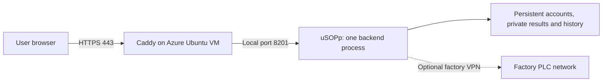

# uSOPp on Microsoft Azure

This guide prepares a **fresh cloud demo for five regular users plus Admin**.
It uses an Ubuntu VM, a persistent data directory, systemd and HTTPS. No Azure
resources have been created by preparing these files. The local installation
and the existing SpinConnect Ubuntu server are independent of this deployment.

## 1. Microsoft 365 and Azure

You can use your organization's Microsoft account to access Azure. A Microsoft
365 license provides an identity tenant; running a VM requires an **Azure
subscription with separate billing**. Check [Azure portal](https://portal.azure.com)
→ **Subscriptions**. If there is no usable subscription, ask your IT/Azure billing
administrator to add one. [Microsoft subscription and tenant guide](https://learn.microsoft.com/en-us/microsoft-365/enterprise/subscriptions-licenses-accounts-and-tenants-for-microsoft-cloud-offerings?view=o365-worldwide)

This deployment uses the existing uSOPp usernames/passwords. Signing in with
Microsoft 365 inside the app requires a later Microsoft Entra integration; it
has not been implemented here.

## 2. Deployment layout



| Item | Location / purpose |
| --- | --- |
| Application source and built interfaces | `/opt/usopp/current` |
| Python runtime | `/opt/usopp/current/.venv-ubuntu` |
| Accounts, uploads, exports, test IDs, history and editable knowledge | `/var/lib/usopp` |
| Application environment | `/etc/usopp/usopp.env` |
| Application service | `usopp.service` |
| HTTPS configuration | `/etc/caddy/Caddyfile` |
| Backend port | `127.0.0.1:8201`, accessible only on the VM |

Use **one VM and one backend process** for this release. Its running job tables
and concurrency locks are held in that process. Five engine slots can be used
by the five users and Admin; further work waits for a slot. Multiple VM replicas
or Uvicorn workers require shared job coordination and are a later change.

## 3. Create the VM in Azure portal

Use [Microsoft's Linux VM creation guide](https://learn.microsoft.com/en-us/azure/virtual-machines/linux/quick-create-portal).
Select these values for this app:

| Setting | Demo value |
| --- | --- |
| Resource group | `usopp-demo-rg` |
| VM name | `usopp-demo` |
| Image | Ubuntu Server **24.04 LTS, x64 / Gen2** |
| Region | A region approved by your organization, near your users |
| Size | Start with **4 vCPU / 16 GB RAM**; this is a planning estimate, not a measured capacity guarantee |
| OS disk | Start with **128 GB managed SSD**; uploaded projects and retained reports need additional space over time |
| Authentication | SSH public key |
| Administrator username | `azureuser` |
| Public IP | Static public IP |

Review Azure's displayed price before creating the VM. VM, storage, networking
and optional AI services have their own charges. Create a budget in Cost
Management; budget alerts do not automatically stop the application.
[Azure VM cost monitoring](https://learn.microsoft.com/en-us/azure/virtual-machines/cost-optimization-monitor-costs)

Save the SSH private key in your Windows Downloads folder as `usopp-cloud.pem`.
Copy the VM's public IP. In its Network security group (NSG), configure:

| Inbound TCP port | Source |
| --- | --- |
| 22 (SSH) | Your administrator's public IP only |
| 80 (certificate challenge / HTTPS redirect) | Internet |
| 443 (application HTTPS) | Company/VPN/user public IP ranges for the internal demo |
| 8200–8500 | No public allow rule |

The app currently allows self-registration up to its account limit. Keep the
internal demo restricted to the intended users' network ranges. Invitations,
approval of registrations and Microsoft sign-in are future integrations.

## 4. Choose the HTTPS hostname

You can use your own domain, such as `usopp.yourcompany.com`, with an A record
pointing to the VM's static public IP. Alternatively, set a **DNS name label**
on Azure's public IP resource and use the actual full hostname Azure displays.
A separately purchased domain is not required for that Azure hostname.
[Create an Azure VM DNS name](https://learn.microsoft.com/en-us/azure/virtual-machines/create-fqdn)

The hostname must resolve to this VM before enabling Caddy. Keep port 80
reachable for certificate issuance/renewal. Follow [Caddy's HTTPS prerequisites](https://caddyserver.com/docs/quick-starts/https).

## 5. Prepare and transfer the cloud ZIP (Windows PowerShell)

The supplied cloud ZIP is a fresh installation. It excludes your local accounts,
uploaded customer projects, private results/history, AI credentials/settings,
model weights, installed dependencies and the large local B&R help archive.
Bundled master mappings, engineering rules and department data models are included.
Server administrators can read the source code; source concealment is deferred.

To create another ZIP from this checkout:

```powershell
cd 'C:\Users\PTPL0241\Projects\AI_QC\uaopp.ai\usopp_ai_2.0'
& .venv/Scripts/python.exe scripts/package_cloud.py
```

Use the newest generated ZIP and replace the placeholder public IP:

```powershell
$usoppCloudZip = (Get-ChildItem -Path '.\release\azure-source\*\uSOPp_AI_*_Azure_Source.zip' | Sort-Object LastWriteTime -Descending | Select-Object -First 1).FullName
$usoppSshKey = Join-Path $env:USERPROFILE 'Downloads\usopp-cloud.pem'
$usoppPublicIp = 'REPLACE_WITH_AZURE_VM_IP'
scp -i $usoppSshKey $usoppCloudZip "azureuser@${usoppPublicIp}:~/"
ssh -i $usoppSshKey "azureuser@${usoppPublicIp}"
```

The commands below run inside **Ubuntu**, not Windows PowerShell. Run commands
in order and resolve any error before continuing. Use a new VM with no existing
web application for this demo.

## 6. Install system dependencies and Node

Ubuntu 24.04 provides Python 3.12. Check each command separately:

```bash
cat /etc/os-release
python3 --version
sudo apt update
sudo apt install -y python3-venv python3-pip python3-dev build-essential pkg-config libcairo2-dev curl ca-certificates unzip rsync gnupg
```

The Cairo development package and pkg-config support the PDF dependencies.
[Pycairo prerequisites](https://pycairo.readthedocs.io/en/latest/getting_started.html)

Install Node 24 under your normal SSH account using [nvm](https://github.com/nvm-sh/nvm#installing-and-updating):

```bash
export NVM_DIR="$HOME/.nvm"
touch "$HOME/.bashrc"
curl -fsSL https://raw.githubusercontent.com/nvm-sh/nvm/v0.40.8/install.sh -o "$HOME/usopp-nvm-install.sh"
PROFILE="$HOME/.bashrc" bash "$HOME/usopp-nvm-install.sh"
. "$NVM_DIR/nvm.sh"
nvm install 24
nvm alias default 24
nvm use 24
node --version
npm --version
command -v node
command -v python3
```

The Node executable will be under your account's `.nvm` folder. No manual system
PATH replacement is needed. The application service uses an absolute Python
path and does not require Node at runtime.

## 7. Extract and build the application

Replace the ZIP filename below if your release version differs:

```bash
mkdir -p "$HOME/usopp-cloud-stage"
unzip "$HOME/uSOPp_AI_4.65.5_Azure_Source.zip" -d "$HOME/usopp-cloud-stage"
sudo install -d -m 755 /opt/usopp/current
sudo chown "$(id -un):$(id -gn)" /opt/usopp/current
rsync -a "$HOME/usopp-cloud-stage/usopp_ai_2.0/" /opt/usopp/current/
cd /opt/usopp/current
python3 -m venv .venv-ubuntu
source .venv-ubuntu/bin/activate
python3 --version
npm run server:install
```

Wait for **Installation complete**. This command installs Python packages and
both frontend dependency sets, then builds both interfaces. Do not use `npm
start` for this deployment: the systemd service below manages startup, shutdown
and reboot recovery.

## 8. Create persistent storage and initialize Admin

```bash
sudo useradd --system --user-group --home-dir /var/lib/usopp --shell /usr/sbin/nologin usopp
sudo install -d -o usopp -g usopp -m 700 /var/lib/usopp
sudo install -d -o root -g root -m 755 /etc/usopp
sudo install -o root -g root -m 600 /opt/usopp/current/deploy/azure/usopp.env.example /etc/usopp/usopp.env
sudo -u usopp env USOPP_DATA_ROOT=/var/lib/usopp /opt/usopp/current/.venv-ubuntu/bin/python /opt/usopp/current/scripts/cloud_admin.py
```

Enter a **new 12-to-128-character Admin password** twice when prompted. It does
not appear on screen, in a shell command or in the environment file. Keep it
in your organization's password manager. The script stores a password hash;
existing accounts/passwords are preserved if the data directory was already
initialized. The service refuses to start with the known local-demo Admin password.

`/etc/usopp/usopp.env` keeps the engine-job limit at five; the account count has
no fixed cap. Edit it later with `sudo nano /etc/usopp/usopp.env`; restart the
service after changing settings. AI is optional: a local model or an API
endpoint requires separate configuration and resources.

## 9. Install the service and start

Make the installed source read-only for the service; editable knowledge and
all results remain in `/var/lib/usopp`:

```bash
sudo chown -R root:root /opt/usopp/current
sudo chmod -R go-w /opt/usopp/current
sudo install -o root -g root -m 644 /opt/usopp/current/deploy/azure/usopp.service /etc/systemd/system/usopp.service
sudo systemctl daemon-reload
sudo systemctl enable --now usopp
sudo systemctl status usopp --no-pager
curl -fsS http://127.0.0.1:8201/api/health
```

Health should report the version from `package.json`. The service runs one
Uvicorn process and trusts HTTPS/client forwarding only from the local proxy,
so same-origin account requests and secure session cookies work through Caddy.
[Uvicorn proxy settings](https://www.uvicorn.org/settings/)

## 10. Install Caddy and enable HTTPS

Use [Caddy's Ubuntu package installation](https://caddyserver.com/docs/install#debian-ubuntu-raspbian):

```bash
sudo apt install -y debian-keyring debian-archive-keyring apt-transport-https
curl -1sLf 'https://dl.cloudsmith.io/public/caddy/stable/gpg.key' | sudo gpg --dearmor -o /usr/share/keyrings/caddy-stable-archive-keyring.gpg
curl -1sLf 'https://dl.cloudsmith.io/public/caddy/stable/debian.deb.txt' | sudo tee /etc/apt/sources.list.d/caddy-stable.list
sudo chmod o+r /usr/share/keyrings/caddy-stable-archive-keyring.gpg
sudo chmod o+r /etc/apt/sources.list.d/caddy-stable.list
sudo apt update
sudo apt install -y caddy
sudo install -o root -g root -m 644 /opt/usopp/current/deploy/azure/Caddyfile /etc/caddy/Caddyfile
sudo nano /etc/caddy/Caddyfile
```

Replace `usopp.example.com` on the first site line with **your actual hostname**.
Leave `127.0.0.1:8201` unchanged. Save with Ctrl+O, Enter; exit with Ctrl+X.

```bash
sudo caddy validate --config /etc/caddy/Caddyfile --adapter caddyfile
sudo systemctl enable caddy
sudo systemctl reload caddy
sudo systemctl status caddy --no-pager
```

Caddy obtains and renews the HTTPS certificate when DNS and network access are
correct. Its reverse proxy allows up to 900 seconds for backend response headers
to accommodate longer exports/validations; it cannot override browser or
application timeouts. [Caddy reverse-proxy configuration](https://caddyserver.com/docs/caddyfile/directives/reverse_proxy)

If Ubuntu's firewall is active, allow SSH before changing firewall rules:

```bash
sudo ufw allow OpenSSH
sudo ufw allow 80/tcp
sudo ufw allow 443/tcp
sudo ufw status
```

These rules do not enable UFW if it is inactive. Azure's NSG rules from step 3
remain required. Do not open the backend port to the Internet.

Open **`https://YOUR_HOSTNAME`** in your browser, sign in as **Admin**, and create
the regular users through User management. Authorized users may also create
their own accounts. Each person should use their own account.

## 11. Use projects and DataInspect from the cloud

- Upload projects and metadata through the browser. A Windows `C:\...` path
  identifies a file on your PC and cannot be read directly by the Azure VM.
- For MatchView, upload both base and developed projects.
- ByteMap, LogicScan, comparisons, generated metadata, DataInspect log decoding
  and saved history can use files available on this server.
- Live DataInspect reads execute **from the server**. A browser on the factory
  LAN does not give the cloud backend access to `192.168.x.x` PLC addresses.
- For live PLC reads, your IT/network team must configure a factory-to-Azure
  private route/VPN and the permitted PLC ports. Keep PLC access on that private
  connection. [Microsoft site-to-site VPN guide](https://learn.microsoft.com/en-us/azure/vpn-gateway/tutorial-site-to-site-portal)

Chopper's AI replies require a configured model; validation engines and local
log decoding work independently. A small VM running the web app is not a
capacity estimate for running an additional language model.

## 12. Daily commands and backups

```bash
sudo systemctl status usopp --no-pager
sudo systemctl start usopp
sudo systemctl stop usopp
sudo systemctl restart usopp
sudo journalctl -u usopp -n 100 --no-pager
sudo journalctl -u caddy -n 100 --no-pager
df -h /var/lib/usopp
```

`npm run status` tracks the separate Ubuntu demo launcher, not systemd. For the
cloud installation, use `systemctl`. Wait for users' active jobs to finish before
stopping/restarting. Completed results persist; in-flight jobs are not guaranteed
to resume after a restart.

Back up with the application stopped so accounts, database journals, results
and filesystem data are consistent:

```bash
sudo systemctl stop usopp
usopp_backup_stamp=$(date +%Y%m%d_%H%M%S)
sudo install -d -o root -g root -m 700 /var/backups/usopp
sudo tar -czf "/var/backups/usopp/usopp-${usopp_backup_stamp}.tar.gz" -C / var/lib/usopp etc/usopp etc/caddy/Caddyfile
sudo chmod 600 "/var/backups/usopp/usopp-${usopp_backup_stamp}.tar.gz"
sudo systemctl start usopp
```

Retain a protected copy outside this VM, or arrange Azure VM backup through IT.
The backup contains private projects, password hashes and optional model API
settings. Restoring must preserve all `/var/lib/usopp` content together, including
hidden directories, because history/ownership records reference retained files.
Do not store this backup in a web-accessible folder.

## 13. Apply a later release

Transfer a new source ZIP and extract it into a **new staging directory**. With
users' work completed and a backup made, stop the service and apply the update:

```bash
sudo systemctl stop usopp
sudo chown -R "$(id -un):$(id -gn)" /opt/usopp/current
rsync -a "$HOME/usopp-cloud-stage-NEW/usopp_ai_2.0/" /opt/usopp/current/
cd /opt/usopp/current
. "$HOME/.nvm/nvm.sh"
nvm use 24
source .venv-ubuntu/bin/activate
npm run server:install
sudo chown -R root:root /opt/usopp/current
sudo chmod -R go-w /opt/usopp/current
sudo -u usopp rsync -a /opt/usopp/current/knowledge/data_models/ /var/lib/usopp/knowledge/data_models/
sudo install -o root -g root -m 644 /opt/usopp/current/deploy/azure/usopp.service /etc/systemd/system/usopp.service
sudo systemctl daemon-reload
sudo systemctl start usopp
sudo systemctl status usopp --no-pager
```

Replace `usopp-cloud-stage-NEW` with the newly extracted staging directory. Keep
`/var/lib/usopp`, `/etc/usopp/usopp.env` and the edited Caddyfile. Editable master
knowledge/rules are seeded once and preserved; review changed default rules
with Admin rather than replacing your approved settings. Fixed bundled data
models are refreshed separately above. The ZIP is not a migration of accounts
or results from the existing Ubuntu server.

## 14. Troubleshooting and deployment record

| Symptom | Action |
| --- | --- |
| No Azure subscription | Have IT/billing add a subscription before creating resources |
| Python below 3.11 | Use Ubuntu 24.04/Python 3.12, or the separate Python setup in UBUNTU_DEMO.md |
| Cairo / pkg-config error | Install step 6's system dependencies before repeating the build |
| Missing xlsx / frontend build error | Use this complete release; `npm run server:install` installs Nami before building |
| Admin check prevents startup | Run step 8 before starting; existing demo passwords must be changed privately |
| Port 8201 already used | Check `sudo ss -ltnp 'sport = :8201'`; do not stop an unrelated service |
| HTTPS certificate unavailable | Check hostname DNS, port 80 NSG/UFW rules, and Caddy's journal |
| 502 response | Check `systemctl status usopp` and the application journal |
| Sign-in returns origin error | Retain the proxy headers and one HTTPS hostname; do not expose/directly browse the backend |
| PLC connection timeout | Verify the VM-to-factory private route and PLC firewall with IT |
| Source update not visible | Rebuild both frontends, restart systemd and reload the browser |

If an **existing** Admin still has the local-demo password, keep cloud access
disabled. Stop systemd, run the backend bound only to loopback as the `usopp`
user, and connect from Windows with an SSH tunnel:

```bash
sudo -u usopp env USOPP_DATA_ROOT=/var/lib/usopp /opt/usopp/current/.venv-ubuntu/bin/python -m uvicorn backend.app:app --host 127.0.0.1 --port 8201
```

In a second Windows PowerShell terminal:

```powershell
ssh -i $usoppSshKey -L 8201:127.0.0.1:8201 "azureuser@${usoppPublicIp}"
```

Open `http://127.0.0.1:8201` on your PC, change the password in Account settings,
stop the temporary backend with Ctrl+C, then start systemd. This procedure
preserves existing accounts and avoids resetting another person's password.

Record the subscription/resource group, region, VM size, hostname, current app
version, backup location, deployed-by/date and any VPN configuration. Cloud
provisioning, HTTPS, reboot behavior, five-user load and live PLC connectivity
still require checks on the actual destination. Preparing these files does not
establish those deployment results.
