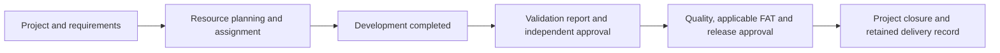

# uSOPp.ai — application features and WorkHub delivery workflow

Verified against the current checkout on 2 November 2026 (Asia/Calcutta).

Follow-up changes: [six delivery handoffs and landing copy](WORKHUB_DELIVERY_20261102.md), [updated parameter mappings, deletion and viewport checks](PARAMETER_MAPPINGS_20261102.md), and [calendar date filters and the default Portfolio & delivery Overview](WORKHUB_DATES_OVERVIEW_20261103.md), and [dashboard tabs and customizable Projects cards and graphs](WORKHUB_DASHBOARD_WORKSPACE_20261103.md), and [top submenus, MatchView filters/exports and chat sizing](NAVIGATION_MATCHVIEW_CHAT_20261103.md), and [compact Spin Connect workspace controls and the top assistant](COMPACT_WORKSPACE_BAR_20261103.md), and [Document Compare in AI Assist](DOCUMENT_COMPARE_20261103.md).

uSOPp.ai combines engineering checks, project delivery, controlled documents and
technical investigation. The landing page now presents these areas together.
The top bar groups profile/password/sign-out into an accessible account menu,
retains notifications and theme switching, and shows a compact build indicator.
The complete UI/API version is available in the account menu. It is a build
indicator, not a security certification.

## Engineering tools

| Area | Implemented purpose |
|---|---|
| WorkHub | Project requirements, planning, assignments, updates, documents, review, quality and closure. |
| ByteMap / MetaWorks | SpinConnect packet layout and offset checks, metadata/HMI mapping validation, workbook generation and source-linked findings. Write ST prepares editable code drafts for review. |
| DataInspect | Live and captured SpinConnect packet decoding, YBS device frames, target-specific metadata, collection and configurable dashboards. Physical-target writes require the existing explicit controls. |
| MatchView | PLC project revision comparison and electrical drawing comparison, change evidence and report exports. |
| LogicScan | Configured engineering rules, feature pipelines, accepted alternatives, evidence and result reports. |
| e-design | PDF drawing review, revision clouds, markers/highlights, comments, reference numbers, correction status, properties and reviewed exports. |
| Chopper / KnowHub | Source-linked investigation and drafting, rule configuration, reviewed technical knowledge, machine/HMI/settings/hardware context and bounded graph inspection. Unsupported semantics and stale evidence remain unresolved. |
| Virtual workspaces | Supported Virtual PLC model inspection and native electrical editing/simulation. Electrical imports exclude recognized ancillary content and require review before simulation. Motor mechanics and arbitrary vendor models are not implemented. |
| Document Compare (AI Assist) | Compare selected CSV/XLS/XLSX columns with optional row keys, or compare PDF/DOCX/TXT extracted text. Source references, difference filters, private results and CSV export are available. |
| Settings and accounts | Account approval, roles, module visibility, profile/password, templates, machine/department configuration, local services and connection settings. |

AI proposals, parser coverage and simulation outputs do not replace physical
tests, engineering confirmation or approval. Optional Office, OCR, transcription
and model services depend on the installed/configured local services.

## WorkHub navigation and features

| Entry | What the team uses it for |
|---|---|
| Overview | Saved, customizable dashboards, project progress, delivery stages, approvals, activity and authorized reports. |
| My Work & Approvals | Assigned work, submitted items, corrections, pending reviews and the current user's next actions. |
| Projects | Direct project access, project creation, filtering, details, tracking, task planning, evidence, issues and team management. The redundant Project Portfolio submenu was removed. |
| Document Management | Controlled MOM, FRD, validation/test reports, FAT and closure documents, with revisions, source files, review and approval history. |
| Competency Hub | Existing capability, performance, training and work-evidence views according to account permissions. |
| TechShare | Reviewed contributions and reusable technical knowledge with their existing review and visibility controls. |

Within a project, the main sections are **Overview**, **Meetings & Requirements**,
**Engineering Documents**, and **Quality & Closure**. Project planning also exposes
the existing workflow/timeline, backlog/sprints, updates, issues and approval
history in their contextual views.

Subsequent update: [independent documents, editable document information,
Flowchart and Mind Map workspaces](WORKHUB_INDEPENDENT_DOCUMENTS_20261104.md).
Document creation now gives each document its own identity, with optional
project prefilling and FRD links. Diagrams have separate numbers, revisions,
manual drawing tools and reviewable Chopper proposals.

Team Management shows actual resource totals, assigned/available capacity,
roles/skills, workload and project progress. Engineers can search/filter resources,
inspect workload, and use the existing authorized assignment controls. Counts are
calculated from saved records, not sample dashboard numbers.

## Project management workflow

1. **Create the project.** Enter Basic Information, Requirements, Workflow, then
   Review & Create. Detailed requirement rows, acceptance criteria, deliverables,
   references and assignments are available. Creating a prefilled FRD is optional;
   it creates a draft, not an approved specification.
2. **Establish the requirement baseline.** Record meetings, decisions, action
   owners, dates and clarifications. Edit and review the MOM/FRD, maintain stable
   requirement IDs, and submit the exact saved revision for approval. The FRD can
   contain an editable functional flowchart. Unknown behavior remains a question.
3. **Plan the work.** Adopt the configured workflow, create tasks/dependencies,
   assign owners/resources and set dates/estimates. Use the available timeline,
   Kanban, backlog or sprint controls. Updating a template does not silently
   replace an existing project's adopted procedure or completed tasks.
4. **Develop and verify.** Engineers update their work and attach source files,
   changes and actual tool results. Link saved engineering runs explicitly through
   the authorized project/work context. An unassigned run is not automatically
   treated as a new approved project or physical test. After development tasks
   and required deliverables are complete, choose Submit for Validation and
   select the saved Validation Test Report revision.
5. **Review and resolve corrections.** Submit the saved document/work revision to
   the assigned reviewer. Rejection/correction remarks and revised submissions
   remain in the record. Editing confirmed content clears confirmation; approvals
   apply to the submitted revision, not later unsaved changes.
6. **Complete quality checks.** Quality & Closure follows the configured FRD →
   Correction Notes → Test Report → applicable FAT → Quality Approval → Project Closure
   process. Record actual outcomes and evidence against requirements. Missing
   execution evidence, mandatory failures and unresolved nonconformances are not
   converted into passes by AI or a completion percentage.
7. **Approve release and close.** Complete required quality/release approvals and
   closure gates, including final deliverables, handover and required acceptance.
   Development completion alone does not mean the project is
   released. Retain the source documents, requirement links, revisions, test
   records, approval identities and package history for later review.
8. **Reuse knowledge.** Reviewed documents/contributions can support later work.
   Reusing content creates an editable draft; it does not copy the previous
   project's approval or physical test acceptance.

The default quality procedure requires independent author/reviewer identities.
Project roles, configurable procedures and backend gate checks remain in force;
an administrator can configure a documented alternative where supported. This
workflow supports traceability but does not itself establish ISO certification.

## Initial landing and security delivery checks

- Production builds passed for the main interface, standalone comparison report,
  DataInspect and Virtual PLC with Vite 6.4.5.
- Browser checks passed for four landing-page widths, eight light/dark top-bar
  layouts, account-menu keyboard controls, profile access, the default-password
  reminder, notification dismissal and sign-out.
- A regression run using isolated patched Python libraries passed 166 tests and
  18 subtests, including account/security, drawing/electrical, metadata and
  WorkHub project/workflow behavior.
- The live Python package upgrade was blocked by automatic approval review;
  see [the security review](LOCAL_SERVER_SECURITY_20261102.md) for the remaining
  maintenance and deployment requirements.

Existing project records, assignments, approvals and packet validation source
were not rewritten to create this summary. Artifacts are retained under
`.build/landing-security-20261102/`.

## Latest delivery, mappings and fit verification (3 November 2026)

- WorkHub: 144 tests and 21 subtests passed for the six delivery updates.
- Mapping and metadata: 51 tests and 11 subtests passed. The live master now
  contains all 1,129 rows from the supplied replacement CSV, with a backup of
  the previous 1,263 rows.
- Browser checks passed for row/bulk deletion, Cancel, saved deletion after
  reload, exact CSV replacement and 162 viewport layouts across workspace
  pages and standalone tools. Browser zoom remains user controlled.
- All four frontend builds passed. Compiled packet CLI, comparison and rule
  engine checks passed from the staged runtime without developer Python source.
- The local server was restarted. Eight live read API checks returned 200,
  including the updated master mappings, WorkHub resources, DataInspect targets
  and Virtual PLC projects. Mutation and revision scenarios used isolated data.
- Docker source inputs and checksum passed inspection, including the updated
  mappings and required build scripts. No Linux container image was built;
  Docker is unavailable on this workstation.

Current evidence is retained under `.build/workhub-delivery-20261102/` and
`.build/parameter-mappings-20261102/`. These checks cover the tested endpoints
and scenarios; they do not exercise physical PLC writes or optional external
service integrations.

## Windows/Ubuntu Docker handoff (3 November 2026)

The current 4.99.3 build passed 174 UI layout checks, 202 tests and 35 subtests,
plus authenticated packaged-runtime API checks. The root Dockerfile has Ubuntu
and Windows Docker Desktop/Linux-container profiles with version-aware builders.
Both host launchers and the Studio print assets are included in the build bundle.
The Linux image itself could not be built locally because Docker/WSL is absent.
See [the complete verification and host instructions](DOCKER_WINDOWS_UBUNTU_20261103.md).
