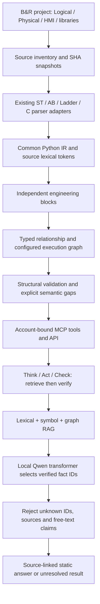

# Chopper engineering foundation and investigation harness — 4.97.3

Subsequent retrieval update: [local hybrid retrieval, reranking and typed publication checks](CHOPPER_HYBRID_RETRIEVAL_20261105.md).

Subsequent work: [shared machine names, settings, hardware and function-call decoding for Chopper and Virtual PLC](CHOPPER_MACHINE_CONTEXT_20261102.md).

Implemented and checked on 30 October 2026. This is the first independent block/graph foundation. It does not certify complete machine understanding or replace incomplete PLC semantics with model guesses.

## Architecture

Each routine file is inspectable on its own. Multiple explicit routines/functions in one file become separate blocks; empty initialization routines are retained. A subroutine is an engineering block, not automatically a newly generated IEC `FUNCTION_BLOCK` declaration. Python holds normalized data and analysis; the engine does not translate the PLC project into executable Python or simulate scan timing.

Blocks include program manifests, tasks, routines, callable definitions/declarations, function-block instances and ports, scoped variables, type declarations, states, Ladder networks, operations, HMI controls and I/O channels. Each carries source path/range, identity, scope, language, layer, properties and status. Routine interfaces reference their read/write/local symbols, declared ports and assigned tasks. Identical variable names in different private program/function scopes stay separate.

Relationships include `CONTAINS`, `CALLS`, `READS`, `WRITES`, `CONTROLS`, `TRANSITIONS`, `EXECUTES`, `EXECUTES_IN`, `INSTANCE_OF`, `MEMBER_OF`, `BINDS_INPUT`, `BINDS_TO` and `MAPS_TO`. `NEXT_IN_SOURCE` describes progression within a source branch and never asserts a cross-task schedule. Named simple input/output arguments get explicit instance-port bindings; complex expressions remain open checks.

CPU task `Source` entries resolve to program manifests and their actual file memberships. `_INIT`, `_CYCLIC` and `_EXIT` phases come from explicit wrappers, including Ladder wrappers. A source named `main` is not presumed to be the starting point. Active, inactive, disabled and unassigned contexts remain distinguishable. Configured call reachability is reported separately from actual invocation.

The source-token table contains language lexical tokens with line/column positions. These are distinct from the neural model's subword tokens. Concept tags describe known block kinds/phases/language and source names; they are not learned embeddings.

## Concept implementation check

| Requested concept | Current implementation and verification |
|---|---|
| Neural network | Existing installed Qwen2.5-Coder GGUF inference is used. Runtime metadata reports 3,397,103,616 parameters. No new model training is claimed. |
| Transformer | The local Qwen transformer remains the model provider. Graph decoding, source relationships and validation stay deterministic. |
| Think → Act → Check / “harness 2” | Two bounded passes: identify/retrieve, then check graph facts and exact source hashes. Diagnostic memory is saved under the owner-scoped project index. No endless loop that forces an expected answer. |
| RAG | Existing FTS/exact-symbol retrieval plus the new engineering graph supplies relevant source evidence and typed facts. The model selects from checked fact IDs. This is graph/lexical RAG; dense embeddings/vector retrieval are not implemented in this milestone. |
| Context window | Increased this installation from 4,096 to 8,192 tokens through the existing settings mechanism. The running server confirms 8,192. Its model metadata reports a 32,768-token training context. Actual tokenizer fitting still budgets instructions, question, facts, excerpts and reserved answer tokens. |
| Hallucination checks | Reject unknown fact IDs, unknown citations, free-text model behavior claims, changed source hashes, ambiguous symbols and unresolved controlling syntax. Render accepted facts from graph records. These controls do not prove that every parser interpretation is correct. |
| Memory / learning | Store question, selected symbol, graph revision, passes and checks as private diagnostics. No automatic promotion into approved knowledge or weight training. |
| AGI | Not implemented or claimed. A bounded engineering tool agent is not AGI. |

The local CPU model was checked before changing context: 4,096 runtime context, 32,768 training context, idle inference slot, approximately 32 GiB machine RAM and 10.75 GiB then available. The new 8,192-token runtime started successfully and completed real inference. The observed model working set after loading/inference was about 3,499 MiB. Model, CPU threads, provider and answer reserve were retained; no new model was downloaded.

## Real project foundation checks

| Measurement | Project 2 | SC_PV5046 |
|---|---:|---:|
| Files accounted for | 1,599 | 1,090 |
| Existing search index records, unchanged | 887 | 597 |
| Executable files parsed without notices | 154 | 110 |
| Executable files with partial parser coverage | 12 | 0 |
| Structured configuration/HMI files | 431 | 315 |
| Declaration/configuration files decoded as indexed fields | 285 | 174 |
| Empty files retained | 28 | 12 |
| Excluded generated files | 391 | 0 |
| Unsupported resources retained in inventory | 298 | 479 |
| Routine / function / function-block definition blocks | 214 | 126 |
| Program manifests | 70 | 38 |
| Task blocks, all configurations | 132 | 74 |
| Active execution contexts | 70 | 37 |
| Source lexical tokens | 236,604 | 92,809 |
| HMI binding records | 3,561 | 2,149 |
| I/O mapping records | 211 | 144 |
| Source call relationships | 4,550 | 1,953 |
| Source-parsed state assignment transitions | 210 | 139 |
| Routine blocks reachable from configured active roots/calls | 153 | 82 |
| Unreachable or unassigned routine blocks | 61 | 44 |
| Dangling relationships | 0 | 0 |
| Invalid source spans | 0 | 0 |
| Unresolved semantic/dependency checks | 10,205 | 4,560 |
| Build and inspection duration | 21.38 s | 9.30 s |

The foundation scans supported `.set`/library configuration files omitted by the older retrieval index; it did not alter that index to pretend their counts were the same. Likewise, parsed-file counts do not imply every library implementation, struct member, timer or branch is understood. SC_PV5046 contains no matching `DO_CAN_CHANGER_MOTOR` declaration; its motor trace correctly returns unresolved rather than reusing Project 2's tag.

Project 2's independent graph resolves the mapped can changer motor and retains the complete controlling network, its typed condition facts and separate upstream links. Library-private `TEMP` declarations belong to their callable scopes rather than being merged with project-global tags.

Artifacts: `.build/chopper-foundation/project2/results.json` and `.build/chopper-foundation/sc-pv5046/results.json`. Each contains the actual inventory, validation, configured flow, scoped motor trace, candidate discovery and declaration inspection.

## MCP and API access

The existing authenticated MCP Streamable HTTP server at `/api/mcp/` now exposes:

- `build_engineering_model(project_id)` — explicit local graph build; no PLC edits.
- `get_project_structure(project_id)` — inventory, layers, task roots and validation.
- `get_engineering_blocks(...)` / `get_function_block(...)` — paged block discovery and individual inspection, with optional IR.
- `get_engineering_relationships(...)` / `get_engineering_tokens(...)` — paged data; no fixed first-N-only graph snapshot.
- `trace_signal(project_id, signal, scope, limit)` — writer/read/control and supporting mapping paths.
- `get_execution_flow(project_id, task_id, limit)` — separate task contexts and reachable calls.
- `find_machine_function(project_id, question, limit)` — source candidates, explicitly not verified machine-function classification.
- `validate_graph(project_id, offset, limit)` — structural integrity and paged unresolved checks.
- `compare_engineering_models(project_id, other_project_id, limit)` — block and relationship changes, not proof of behavioral equivalence.
- `investigate_engineering_project(project_id, question, use_model, max_passes)` — explicit two-pass graph RAG tool.

REST inspection lives under `/api/assist/projects/{key}/engineering-model`. Build uses `POST .../build`; investigation uses `POST .../investigate` with `question`, `useModel` and `maxPasses`. Other endpoints expose blocks, relationships, tokens, execution, trace and validation.

Each project key is opened against the signed-in account; callers cannot supply an owner identity to bypass access control. Tests exercise both the production API handlers and actual MCP JSON-RPC initialization/tool calls over the ASGI HTTP transport, including another-account denial.

The new model is stored separately as `engineering_model.sqlite3` beside the owner-scoped project index. Build publishes atomically after integrity checks and retains the previous valid graph on failure. Changed sources, added files, changed index revisions or parser revisions cause stale-model rejection. Full IR and diagrams are opt-in inspection data; ordinary block pages omit them.

## Investigation publication boundary

The two-pass harness retrieves passages and graph relationships, verifies exact SHA snapshots, then creates typed static facts. The neural model receives a compact subset of those facts and source IDs. Its output is restricted to selecting existing fact IDs. It cannot publish a newly written claim such as “the sensor is currently OFF” or “this motor starts because X” merely by adding a citation.

Rejected model selections fall back to the deterministic checked facts. One-pass runs cannot publish controlling claims. Unknown scopes, missing writers and unsupported Ladder instructions produce unresolved results. Source edits during inference prevent publication. Diagnostic memory and context reductions are reported explicitly.

Verified on the actual installed transformer with Project 2's can changer question: **25.03 seconds** total, two investigation passes, five lexical/source sections from three files retrieved, two verified facts published, and valid model fact selection. Actual inference used **1,139 prompt tokens + 22 generated tokens** with a 160-token response reservation, inside the 8,192-token window. The answer identifies the complete static coil expression and the full `%QX."105_X20DO9322".DigitalOutput03` mapping. Physical addresses are decoded from the original I/O source text rather than the older index's shortened symbol key, and their literal presence in the cited source is checked.

The actual llama.cpp tokenizer stress test reduced a **24,267-token** synthetic prompt to **7,335 prompt tokens + 768 reserved answer tokens + 32 margin = 8,135**, within 8,192. It retained a representation of all eight source sections and reported their shortened spans. No inference was requested on the deliberately oversized synthetic prompt. Artifact: `.build/chopper-foundation/project2/harness.json`.

This tool is available through MCP/API. Automatic routing of ordinary Chopper chat to the new foundation remains gated: `automaticChatEnabled=false`, `safeForAutomaticMachineClaims=false`. Broad machine understanding needs the remaining semantic checks resolved and engineer-checked sequence fixtures before that gate can be lifted. This milestone does not claim that the old chat's complete-machine answers are now correct.

## Verification and remaining work

Combined targeted regression suite: **99 passed, 2 skipped**. Coverage includes configured roots versus misleading `main` names, separate task classes, private scopes, instance ports, empty Ladder init routines, tokens, comparison, stale-source rejection, atomic rebuild failure, owner isolation, actual MCP transport, prompt budgets, writer tracing, source publication gates, and rejection of fabricated model fact IDs/citations/free text.

All three production interfaces built successfully. UI/API versions match at **4.97.3**. The Python v1.71 packet validation engine is unchanged. Existing validation state, project workflows, account permissions and model weights were preserved.

Remaining work includes full member/type resolution, complex and positional argument binding, C preprocessing/pointers/aliases, vendor library internals, edge/timer scan semantics, conditional call execution, connected cross-routine sequence proofs and calibrated semantic evaluation. These appear as open checks. Neither structural validation nor a larger context window resolves them by itself.

Reproduce foundation checks with `scripts/verify_engineering_foundation.py --index <existing-key> --label <name>`. Reproduce actual transformer/RAG and tokenizer budget checks with `scripts/verify_engineering_harness.py --index <existing-key>`. These create separate graph/diagnostic artifacts and leave PLC source and the packet validator untouched.
