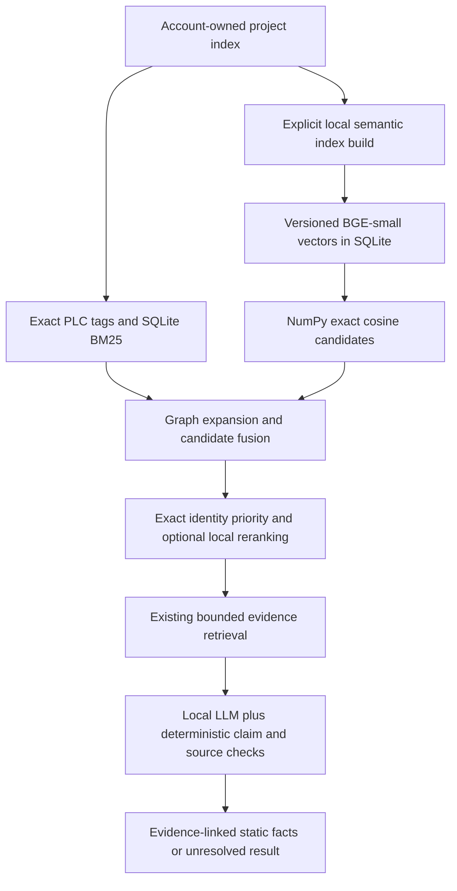

# Chopper architecture review and local hybrid retrieval

Implemented on 5 November 2026 (Asia/Calcutta), following a code/environment review
of the proposed deterministic analysis, graph, RAG, local LLM and analytics stack.

## Gaps identified and addressed

| Area | Reviewed gap | Implementation |
|---|---|---|
| Retrieval | Exact symbols, FTS5/BM25 and graph traversal existed; dense retrieval and a learned reranker did not. | Added local BGE-small embeddings, fused lexical/dense candidate ranking and an optional Jina tiny reranker. Exact-tag and explicit-file matches retain priority. |
| Index provenance | A vector index needs its own owner, parser/source/model revisions and freshness checks. | Separate owner-scoped `semantic.sqlite3`, versioned chunk representations and pinned model hashes; atomic builds retain the last valid index on failure. |
| Confidential model connections | The main Chopper transport permitted external API configuration without a shared local-only policy. | Added a saved local-only control, enforced before chat/check/tokenizer transport, proxy bypass for loopback calls, and enforcement for WorkHub's explicit model override. Existing embedded operation is local-only. |
| Fact publication | The graph harness checked source facts and model selections but used untyped fact dictionaries. | Added strict Pydantic static-fact records and a second exact-byte source hash check after inference, including edits with restored timestamps. |
| User controls | Retrieval models/indexes had no setup or project build controls. | Settings → AI & Chopper exposes installation, enable/disable and reranking controls. Chat → Project Intelligence exposes owner-scoped build/rebuild/status controls. |
| Regression breadth | Named negative fixtures existed, but the new fusion needed identity invariants. | Added deterministic regression, HTTP ownership/admin checks and optional Hypothesis properties for identity priority and rejection of unknown fact IDs. |

Existing custom ST/AB/C/Ladder analysis, engineering graph, MCP, analytics, validator
and source publication gates remain in place. No new PLC interpreter, parser grammar,
ML fault classifier or complete-machine proof is claimed by this change.

## Retrieval and storage

NumPy exact cosine was selected for this bounded first implementation instead of
adding a separate FAISS/Chroma service. It uses the existing NumPy dependency and
does not load pickled indexes. SQLite remains the evidence store. There is no
LangChain dependency or duplicate BM25 implementation. The existing native
llama.cpp runtime serves the two retrieval models separately from chat; a second
Torch/Transformers serving environment is unnecessary.

Enabled source sections are represented by 1200-character chunks with 250-character
overlap, including file/section labels. Actual model tokenizers fit representations
to their limits; the original source excerpts and completeness flags remain intact.
Builds are explicit, bounded to 20,000 chunks and serialized. Dense search retrieves
up to 48 section candidates; the optional reranker handles up to 24 non-pinned
candidates. Ranking scores express relevance only, never engineering confidence.

Each index binds the account/project identity, source inventory and hashes, parser
revision, active-configuration metadata, section content, chunker version and model
revisions. Source bytes and file additions/removals are checked before use, and
source verification runs again after reranking. Other-target physical candidates
are excluded from dense discovery unless inactive/configuration content was asked
for. Identical names in different scopes remain distinct records.

Incomplete, missing, stale, busy or unavailable semantic retrieval produces an
explicit notice and retains the existing lexical/graph path. A change during the
current semantic query blocks its publication. Querying never downloads models or
implicitly rebuilds an index. A failed build retains the previous valid index.

## Local models and connection policy

| Role | Pinned model | Size | Licence |
|---|---|---:|---|
| Embeddings | `ggml-org/bge-small-en-v1.5-Q8_0-GGUF`, revision `f2068edd9b54f2a369549ccc71f70ed273a2a801` | 36,685,152 bytes | MIT |
| Reranking | `gpustack/jina-reranker-v1-tiny-en-GGUF`, revision `34fdafe5a08b64246bcbfdbf0b8a23f818baf8e3` | 36,676,960 bytes | Apache-2.0 |

Setup verifies pinned file sizes and SHA256 before activation. Model attribution,
hashes and upstream locations are retained in `local_ai/models/retrieval-models.json`.
The English retrieval models are not specifically trained on this PLC installation.
Their usefulness for machine-specific names requires evaluation against real queries.

The app owns loopback CPU processes on 8204 and 8205, with two threads each. They
start when needed after installation and stop with the app or when retrieval is
disabled. An occupied port is rejected rather than trusted as a retrieval service.
Windows launcher cleanup recognizes only this checkout's owned local model aliases.
Model files are not bundled into the source-free application by this change.

The existing chat model, context and weights are retained. New local-only installs
accept loopback model endpoints only and ignore system proxies for local requests.
Legacy explicitly remote configurations remain remote until the administrator
enables local-only; embedded transport always requires loopback. Administrators
can explicitly disable local-only for an intentional API service. This policy
covers model transports; it is not an installation-wide network-egress certification.

## Publication and remaining semantic work

The graph harness accepts only typed assignment, rung-condition and physical-mapping
facts already established by deterministic graph/source checks. The LLM still selects
existing fact IDs; it cannot author a new motor state or cause and pass it through
schema validation. After inference, exact source bytes are rehashed before publishing.

`automaticChatEnabled=false` and `safeForAutomaticMachineClaims=false` remain on the
independent foundation. Ordinary chat's trace routes and the independent graph harness
are distinct. Full member/type resolution, complex argument binding, vendor internals,
C preprocessing/pointers/aliases, conditional call execution, cross-task ordering and
connected sequence proofs remain open where their evidence is insufficient. Statistical
outliers remain distinct from approved limits, defects and physical acceptance.

## Operation

1. Open **Settings → AI & Chopper → Local semantic retrieval**. Install/verify the
   two model files and enable hybrid retrieval/reranking. Only explicit setup downloads.
2. Select or attach a PLC project in Chat. Finish its normal source indexing.
3. Open **Project context → Project Intelligence → Build semantic index**.
4. Ask the question. Exact symbols, BM25 and graph tracing remain active; retrieval
   coverage reports whether semantic candidates/reranking actually ran.
5. After source/configuration changes, refresh normal indexing, then rebuild semantic
   retrieval. Source graphs must also be rebuilt when their own revision is stale.

Additional endpoints: admin `GET/POST /api/assist/model/retrieval`, explicit setup
`POST .../retrieval/install`, owner `GET /api/assist/projects/{key}/semantic-status`
and `POST .../semantic-build`. Existing retrieval responses add `semantic` diagnostics.
No caller-supplied owner ID bypasses project access checks.

## Verification

The actual installed models returned 384-dimensional embeddings and learned relevance
scores on the local CPU runtime. Real inference built an isolated engineering sample
index and retrieved source-backed candidates for three questions, including an alias
question about electrical-enclosure cooling and an exact PLC tag. That is a functional
check, not a calibrated general PLC-accuracy benchmark.

Regression logs, model hashes, real retrieval responses, browser results and build
artifacts are retained under `.build/chopper-hybrid-20261105/`. Optional development
tests use `scripts/chopper_test_requirements.txt`; the serving environment does not
require Hypothesis. Current UI/API version remains 4.99.3.
