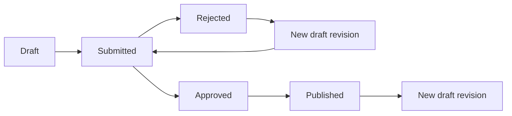

# WorkHub: Performance & Capability and Contribution Passport

## Where to open them

The existing WorkHub navigation now includes **Performance & Capability** and **Contribution Passport**. Project delivery, assignments, approvals, timeline, sprints, Project Intelligence and the engineering tools keep their existing records and routes.

This release adds a read-only collector of engineering/workflow facts. It does not change the PLC validation, comparison, DataInspect, metadata or LogicScan engines or recalculate their results.

## Performance & Capability

### Engineer and team views

- Engineers see their own assigned work, contributed projects, reviewed delivery, documentation, validation results, issue history, capability evidence and trends.
- Project creators/owners see team profiles restricted to the projects they manage. Admin can view company-wide profiles. A project manager is not automatically granted another engineer's unrelated project or general evidence history.
- Published Contribution Passports remain visible in the shared internal knowledge library to signed-in personal accounts. Demo accounts do not access these shared features.
- Evidence cards open the exact native event, submitted evidence record or published knowledge article. Native result JSON and existing project evidence remain downloadable through their existing authenticated endpoints.

### Automatic sources

The collector reads existing WorkHub `events`, `engineering_runs`, `updates`, assignments, issues and approved Project Intelligence document references. It polls every 30 seconds by default and refreshes on dashboard requests. It processes historical native events in batches of 1,000 and keeps a persistent cursor.

Recorded run scores are read from native summary fields and, when available, existing archived top-level `score`, `validationScore` and `overallScore` fields. Scores keep their recorded field names and numeric values. Different tools' scales are not normalized into an employee grade.

Run authors are attributed by numeric account ID. Task association uses an explicit native task link or a single matching task update that shared the run. Multiple matching tasks remain ambiguous; the UI offers a reviewed manual evidence/task-attribution path. A project-level run is not guessed onto whichever task happens to be active.

Private runs that were never shared with WorkHub, demo runs and unowned legacy files are not republished as company performance records. Existing WorkHub automatic capture continues unchanged.

### Indicator definitions

| Indicator | Evidence basis |
| --- | --- |
| Project contributions | Currently assigned projects plus projects with recorded contribution activity; the displayed progress is the existing shared project completion calculation |
| Development completions | Distinct item completion events by the recorded developer; development completion remains separate from release |
| Independently reviewed deliveries | Distinct leaf task quality reviews, or project-level quality review where no task review establishes the same person's contribution; reviewer must differ from the recorded developer |
| Reviewed documents | Distinct Project Intelligence documents approved by a reviewer other than the revision creator |
| On-time reviewed delivery | Current recorded release with an independently reviewed development chain, a preserved due date and actual completion timestamp; unknown or historical changed deadlines are excluded |
| Verified evidence | Distinct independently reviewed native work, approved manual evidence and published reviewed knowledge contributions |
| Validation iterations | Recorded engineering activity, including source summaries and comparison counts; no negative weighting |
| Issue resolutions | Actual resolver activity and issue history; discovery and resolution counts are not failure penalties or automatic proof of technical quality |

Task and project records are not both counted as the same person's reviewed delivery for a project. Repeated approvals of the same deliverable do not inflate the distinct delivery indicator. A draft revision does not remove an earlier approved evidence baseline.

Capability evidence covers **problem-solving, work quality, execution, ownership and knowledge sharing**. The dashboard displays verified record counts and their sources. It uses these evidence labels:

- **Evidence not yet recorded**: no eligible reviewed record in the selected period.
- **Evidence emerging**: at least one eligible record.
- **Evidence-backed strength**: at least three eligible records with at least two project/source contexts.

These labels describe evidence coverage. They are not standardized qualifications, certification, a composite appraisal score or a team ranking. The bar widths are evidence-volume visuals, not skill percentages.

Improvement opportunities use recorded outstanding review comments, assigned open engineering issues and missing verification/documentation. Missing evidence does not become a negative rating. More validation iterations, failed exploratory runs or discovered bugs do not lower the indicators.

Trend charts show the currently eligible distinct evidence records by their review/publication week, plus neutral activity context. Updating an approved revision can move its current evidence record to a newer week; this is not an immutable historical appraisal snapshot.

### Manual evidence and verification

Use **Add evidence** for documentation, research, electrical/circuit design, design reviews, general tasks and work without automatic capture:

1. Enter a short title, work description, result and verification method. Project/task links are optional for general engineering work.
2. Save the draft and attach supporting files or screenshots.
3. Choose an independent authorized reviewer and submit a new revision.
4. The assigned reviewer records verification notes and confirms the supported capabilities, or returns the evidence for correction.

Only approved evidence is used as verified capability support. Drafts, pending submissions and rejected revisions do not increase it. Earlier approved revisions remain available when a new draft is prepared.

## Contribution Passport

### Guided submission

Choose **Share a contribution**. The guide asks category-specific questions one at a time, saves answers as revisions, supports suggested choices and short explanations, and accepts optional attachments/screenshots.

Categories:

- Error Resolution & Troubleshooting
- Project Knowledge Sharing
- Technical Solutions & Improvements
- Research & Learning
- Best Practices & Reusable Methods

The guide prepares a structured article from the actual answers. It works without a language model. An optional **Polish with local model** action proposes wording using the existing private-network Project Intelligence LLM integration. The author still reviews and saves the resulting text.

Review the generated article, edit its title/text/keywords, and choose an authorized reviewer. Main purpose/problem and solution/findings questions must be answered before submission. Unknown root causes and preliminary findings remain labelled as such; no diagnosis or successful test is inferred merely because an article exists.

### Review and publication



- Author-only editing creates a new immutable content revision.
- The named reviewer must be an enabled project owner/creator, quality/release reviewer, project manager or Admin, and must differ from the author.
- Project-less submissions use enabled project managers/Admin as review candidates.
- The assigned reviewer approves/rejects with recorded notes. Approval alone does not put an article in the library.
- The assigned reviewer separately publishes the exact current approved revision. Editing creates a new draft that needs its own review and publication.
- Earlier published revisions remain available as historical sources. Search and retrieval use the current published revision only.
- Published reviewed articles contribute knowledge-sharing evidence. Additional capabilities count only where the reviewer explicitly confirmed them.

Existing notification records are reused. New notifications open the corresponding contribution/evidence workspace. Project-linked notifications retain the existing authorized email/Teams preferences; general contributions use in-app notifications and the review queue. No new mailbox or external messaging permission is introduced.

### Knowledge library and internal assistant

The library supports full-text search with category, author and project filters, detailed article views, keywords, source attachments, revision history and the engineer's published Contribution Passport.

SQLite FTS5 ranks matching published knowledge where available, with a bounded text-search fallback. Drafts, submissions, rejected and approved-but-unpublished revisions are excluded from search and assistant retrieval.

**Ask the library** returns relevant reviewed source excerpts and links to the exact article revisions. An optional configured local model can explain retrieved articles, but must return recognized article citations. If that service is unavailable or its citations are invalid, the system returns the source excerpts rather than an unsupported diagnosis. Long sources are identified as excerpts so engineers can open the complete method and applicability limits.

This is keyword retrieval, not a claim of comprehensive semantic search, automatic machine diagnosis or validated PLC control logic.

## Storage, configuration and Linux deployment

All added records use additive `pc_*` and `cp_*` tables inside the existing `.usopp_workhub/projects.sqlite3` database. Contribution attachments use `.usopp_workhub/contributions/` in the same persistent data volume and are deduplicated by SHA-256.

Existing large project file storage is preserved. Contribution/evidence attachments have their own default limits of **100 MiB per file**, **30 references per revision** and **10 GiB unique attachment storage**. Link large native engineering files through their existing WorkHub project instead of copying them into a knowledge article. Attachment downloads are checked against author/reviewer/manager/published-revision access and are served as downloads, not executable content.

Server options:

```text
USOPP_PERFORMANCE_POLL_SECONDS=30
USOPP_PASSPORT_MAX_FILE_BYTES=104857600
USOPP_PASSPORT_STORAGE_BYTES=10737418240
USOPP_WORKHUB_TIMEZONE=Asia/Kolkata
```

Timeliness uses `USOPP_WORKHUB_TIMEZONE`, then the server's `TZ`, then UTC. Invalid/unavailable zone data falls back to UTC and the effective timezone is disclosed in the methodology. Trend bins use UTC and cover the selected period. Native activity and issue history are paginated in groups of 50.

The features run in the existing WorkHub backend container. They do not require another project/task database, another user directory or extra AI containers for guided entry, search or performance calculation. The existing image build packages the added Python modules and the frontend build adds lazy-loaded WorkHub screens.

The optional overlay [deploy/growth/compose.yaml](../deploy/growth/compose.yaml) supplies the settings while retaining the existing data volume and deployment:

```sh
docker compose --env-file /srv/usopp/deployment.env \
  -f distribution/compose.yaml -f deploy/growth/compose.yaml up -d
```

Build/select the updated normal application image first using the existing deployment procedure. Back up the whole persistent application volume before updating. For SQLite online backups, use the backup API or stop writers; copying a live main database file alone can omit WAL contents.

For optional local AI explanations/polishing, reuse the existing Project Intelligence deployment and configure `USOPP_PI_LLM_URL` and its local model settings. No external AI provider, model download, public endpoint or cloud fallback is added. The same private-network endpoint checks and existing company/VPN access rules apply.

## Implementation evidence and limits

The production build includes the main frontend, Nami and Virtual PLC. Python compilation checks the added backend modules and integration. Following the request to check incomplete requirements, isolated API regression and browser workflow checks were added. See [requirements and verification](WORKHUB_GROWTH_VERIFICATION.md) for coverage and limits. These checks do not establish production scale, model quality or authorization coverage under every account combination.

Release 4.83.0 initially passed build/compilation and local health checks, but had not undergone browser workflow checks. Release 4.83.1 corrects existing-archive collection, original score coverage, latest-iteration ordering, history pagination and draft privacy. Existing attributed native archives now appear privately in their recorded author's profile, without guessing WorkHub project/task links. An author can explicitly submit a source for independent verification and project/task attribution. Linux service and model activation remain skipped at the user's request.

Target Linux container rollout and optional model execution need the company's existing server access/configuration. They are not represented as verified deployments from this Windows workspace. No fabricated engineer scores, contributions, sample projects or test personnel are inserted into company data.
